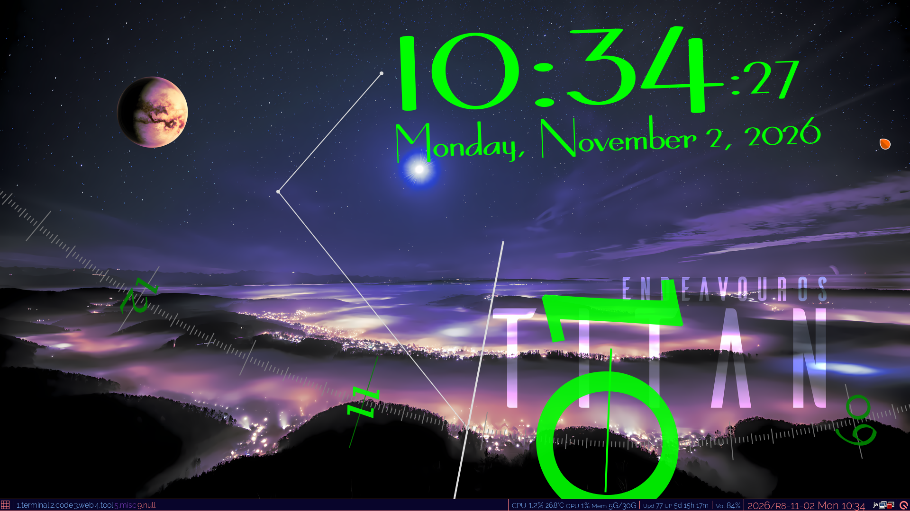
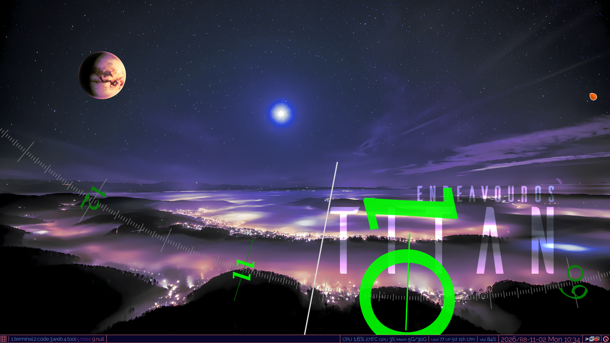
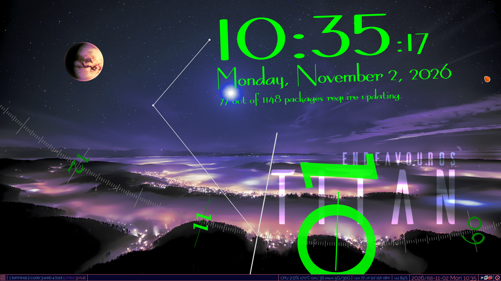
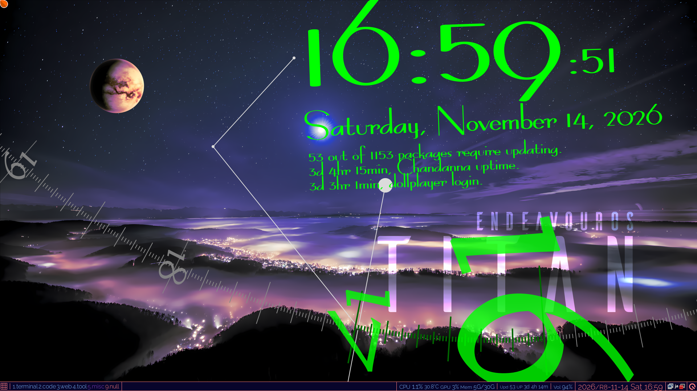
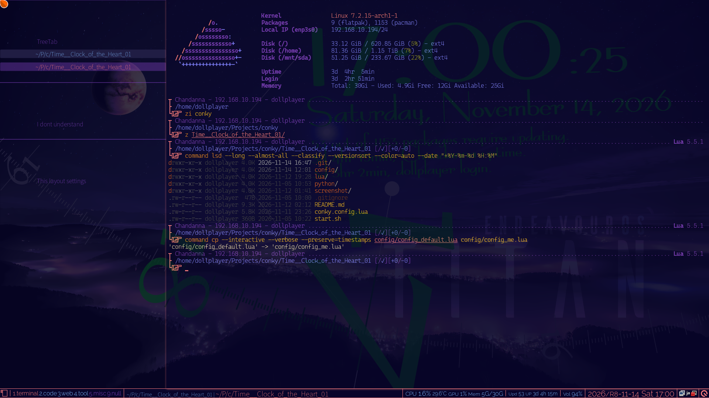
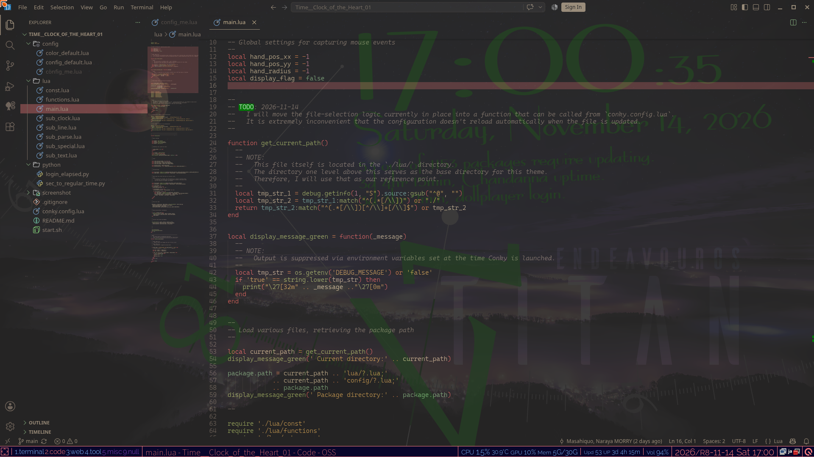
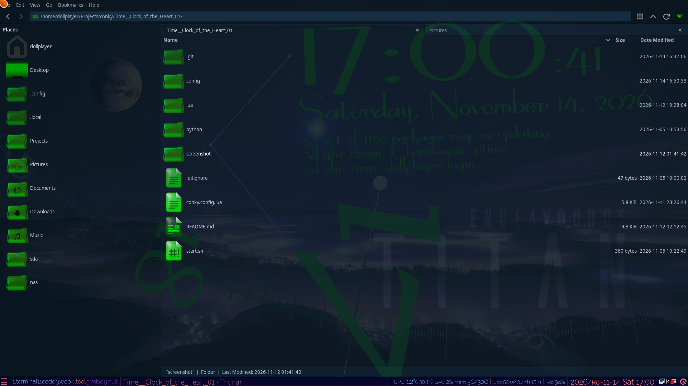

# Conky theme, "Time_Clock_of_the_Heart"

> [!WARNING]
> ~~Currently (as of 2026-11-04),~~  
> ~~changes are being made to the file structure, the methods for loading files, and other related aspects.~~  
> - ~~Updates to this README file will be delayed.~~
> - ~~The file name and location will change.~~

> [!NOTE]
> There may be slight differences between the images shown here and the results produced by the latest source code.

## 1. Overview

Conky theme, a 24-hour clock that uses the entire display. I also use Fish shell scripts and Python scripts that I have created.

### 1.1. Normal mode

In [`./config/config_default.lua`](./config/config_default.lua), at `Info.Display_flag` is `true`, default.

### 1.2. Very simple mode

As with the above, `Info.Display_flag` is `false`.  
(Self-reflection) I’m starting to think that maybe this is fine as it is…

## 2. How to start

> [!NOTE]
> ~~This mechanism is not elegant; it is slated for revision—for instance,~~
> ~~to allow for user-defined configurations and color schemes, 2026-11-04.~~

### 2.1 I just want to get it up and running as soon as possible.

In this case—as I will explain later—there is a possibility that the fonts, in particular, may not display as I intended.

1. Download the source code found here to your local PC in some way.
1. [`sh ./start.sh`](./start.sh)

### 2.2. (After trying out this theme) I see—I get it now. I want to customize it.

I have prepared various configuration settings—such as color schemes and visibility toggles—that I have not yet documented.  
In terms of the logic for this theme, the default [`./config/color_default.lua`](./config/color_default.lua) and [`./config/config_default.lua`](./config/config_default.lua) are assumed to always exist;  
however, if `./config/color_me.lua` and/or `./config/config_me.lua` are present, it will be loaded instead, and the default items will not be loaded.

#### 2.2.1. Adjusting the color scheme

Copy and rename [`./config/color_default.lua`](./config/color_default.lua) to `./config/color_me.lua` (the filename is fixed), then modify `./config/color_me.lua`.

#### 2.2.2. Customization other than color schemes

Copy and rename [`./config/config_default.lua`](./config/config_default.lua) to `./config/config_me.lua` (the filename is fixed), then modify `./config/config_me.lua`.  
However, changing the font settings might be a bit complicated (more on this later).
And I’ve made it possible to configure a rather excessive number of detailed settings, but I’m afraid I have no plans to document them…

## 3. Notes on using this theme

### 3.1. Regarding the fonts used

The following three types of fonts are used:

- [Ptolemy Font](https://www.1001fonts.com/ptolemy-font.html)  
  Used for the dial of a 24-hour clock
- [Bernardo Moda Font](https://www.1001fonts.com/bernardo-moda-font.html)  
  Used for the current time display at the top of the screen and other text.

If the font is changed, I suspect some fine-tuning will likely be required.
With this in mind, I have implemented certain aspects as external parameters or parameter values; however, I am not entirely certain how effective this approach will prove to be.

1. [`./lua/const.lua`](./lua/const.lua)  
  Definition of the font(s) used for this theme.
1. [`./config/config_default.lua`](./config/config_default.lua)  
  Settings for the fonts used in various components. I have endeavored to define literal values ​​here as much as possible.

### 3.2. **Important:** Regarding versatility

I have **NOT** taken into account the kind of versatility that would allow the product to be used by a wide range of people.
The reason is that the following is the theme I am actually using.  

**The following features are not enabled unless the configuration file is modified.**  
To enable this, activate the following flag for [`./config/config_default.lua`](./config/config_default.lua).
To enable this, you must set the flag for `Info.Text.Other.Other_display_flag` and/or `Info.Text.Other.Special_display_flag` within this file.

#### 3.2.1. Displaying the total number of packages and the number of packages currently available for update.

See the 3rd row in the figure below.

In my case, since I am using *EndeavourOS*, this applies to *Arch Linux*.  
See [`./lua/sub_parse.lua`](./lua/sub_parse.lua), `Packages.checkupdates` and `Packages.checkupdates.packman_Q`.

#### 3.2.2. **Important:** Time elapsed since the PC was started, and time elapsed since the current login.  

See the 4th and 5th rows in the figure below.

**These are entirely dependent on my environment**, I would like to standardize the display format for normalized dates.

First:  
For time normalization, I have implemented a separate Python routine as shown below.
Provide a number of seconds to this Python script, it will return a normalized time.  
See [`my_python_sec_to_regular_time.py`](https://github.com/dollplayer2501/dotfiles_ver3_terminal/blob/main/_bin/my_python_sec_to_regular_time.py)

Next:  
The number of seconds elapsed since the PC was booted is obtained by processing `/proc/uptime` with `awk` and passing the result to the aforementioned Python script.  
See [`./lua/sub_parse.lua`](./lua/sub_parse.lua), `Commands.Special.uptime`.

Additionally:  
The time elapsed since login is retrieved using the following Fish shell function that I created.
In other words, it obtains information from `last -1 -F $USER`.  
See [`my_login_elapsed.fish`](https://github.com/dollplayer2501/dotfiles_ver3_terminal/blob/main/fish/functions/my_login_elapsed.fish)  
And [`./lua/sub_parse.lua`](./lua/sub_parse.lua), `Commands.Special.login`.

## 4. TODO

- [x] [HIGH] A review of the script `require` mechanism, along with a major overhaul of how user-specific configurations and color scheme files are set up.
- [ ] Should I also include the Python scripts used within this script?  
      **Unfortunately**, this also included a Fish shell script function that I had created. I’m not yet sure how to handle this; it would be a hassle to rewrite it from a Fish shell script into Python just for this one thing.
- [x] Creating a theme configuration file for public release
- [x] It looks too flat, so I’ll add some touches to give the text a three-dimensional appearance—much like creating drop-shadow lettering.  
      I had a hunch, but I did a quick check. Since this theme uses unnecessarily large text—which would likely lead to a slight increase in CPU load—I’m going to mark this as "pending" and consider it closed.
- Display the following information on a 24-hour clock:
    - [ ] Sunrise, sunset, and lunar data, retrieved via the *U.S. Naval Observatory* API, implemented in Python  
          **Using 'astral', a Python library for solar and astronomical calculations.**
    - [ ] Upcoming scheduled jobs, obtained using `systemctl list-timers --all` and/or `systemctl --user list-timers --all`, implemented in Python
- [ ] Information regarding the historical graph for CPU load:  
      The design calls for a graph that follows the circular path of a clock face, extending inward from the 24-hour hand toward the center.
- [ ] Use *Pywal* to automatically change the color scheme for this theme?
- [ ] Nothing is decided yet, but perhaps adding some kind of feature triggered by a *mouse hover*?
- [ ] I would like to modify the system so that it can start using only the default configuration file I provide.   
      If a user creates a copy and modifies it, those custom keys and values ​​should take precedence.
- [ ] Represent 24 hours a day or 365 days a year using an arc.
- [ ] Once development has reached a relatively stable state, move management to GitHub issues.

- - -

## Motivation for development

- I have a massive, usable workspace measuring 1920x1080 pixels.
- To the question, "*But how are you supposed to see the time?*", I respond as follows:
    - You could just look at a (physical) clock.
    - Since I use *Qtile*—a tiling window manager—I can simply open a dedicated workspace for this display.
    - Thanks to transparency settings in *Picom*, I can see the background if I really want to (though it’s admittedly quite difficult).
    - While I am well aware of the current trend toward widget-based displays, this is simply what I want.

The environment I am actually using is as follows.

  

In practice, I rely on the Qtile widgets (located on the bottom bar) to keep track of the current time, the number of available package updates, and the CPU load.
In other words, no issues will arise even if this theme is not displayed.

See also the following—specifically, my "dotfiles":

- [dotfiles_ver3_terminal](https://github.com/dollplayer2501/dotfiles_ver3_terminal)
- [dotfiles_ver3_window-manager](https://github.com/dollplayer2501/dotfiles_ver3_window-manager)

